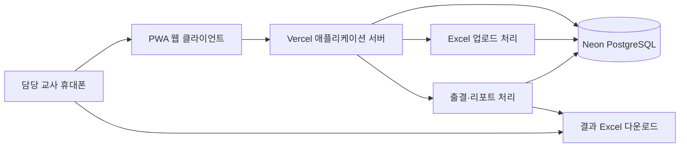

# 야자·심자 관리 시스템

## 애플리케이션 개요

고등학교 야간자율학습(야자)·심야자율학습(심자) 운영을 위한 교사용 관리 애플리케이션입니다.

선생님들이 작성한 Excel 파일을 업로드하면 앱이 날짜·야자/심자 구분별 대상자를 만들고, 담당 교사가 휴대폰에서 참석·입실·퇴실·불참 여부를 기록합니다. 기록이 끝나면 출결 결과가 포함된 Excel 파일을 다운로드하고 주간·월간 리포트를 확인합니다.

- 사용자: 담당 교사 1명
- 대상: 학생 20~40명
- 학생 로그인·신청 기능: 없음
- 핵심 입력: `학번`, `이름`, `반`, `날짜`, `구분`
- 핵심 흐름: Excel 업로드 → 출결 체크 → 결과 Excel 다운로드 → 리포트 확인
- 배포 플랫폼: PWA (Vercel 배포 준비 중)
- 로컬·테스트 DB: SQLite; 배포 DB: Neon PostgreSQL
- 목적: 학교 공식 출결을 대체하지 않는 야자·심자 운영 보조
- 재업로드: 기존 출결을 삭제·덮어쓰지 않고 신규 유효 행만 반영
- 출결 마감: 교사가 최종 상태를 확정하며 미체크는 자동 결석 처리하지 않음

## 전체 아키텍처 다이어그램



핵심 업무 데이터는 PostgreSQL에 저장합니다. 오프라인 출결 저장과 Excel 실시간 양방향 동기화는 MVP에 포함하지 않습니다.

## 시작하기

주요 기능과 PWA 설정이 구현되어 있습니다. 작업 전 다음 문서를 확인합니다.

1. [IDEATION.md](./docs/IDEATION.md): 제품 배경, 목표, 범위, 운영 원칙
2. [ARCHITECTURE.md](./docs/ARCHITECTURE.md): 권장 개발 언어·스택·운영 구조
3. [PRD.md](./docs/PRD.md): 기능 요구사항, 인수조건, 테스트 시나리오

## 사전 개발 환경 요구사항 (Prerequisites)

구현 시작 시 다음 환경을 준비합니다.

- macOS, Windows 또는 Linux
- Node.js 22 LTS
- pnpm
- Git
- PostgreSQL을 쓰는 프로덕션 환경은 Neon Marketplace 연동
- Excel 파일을 확인·작성할 수 있는 프로그램

사용 스택은 TypeScript 5.x(strict), Next.js 15(App Router), Prisma, SQLite(로컬), PostgreSQL(배포), Tailwind CSS, zod, xlsx, Vitest, Playwright입니다.

## 애플리케이션 실행하기 (로컬)

로컬 SQLite로 실행하는 절차입니다.

```bash
pnpm install
cp .env.example .env
pnpm db:push
pnpm dev
```

`.env`에 로컬 `TEACHER_PASSCODE`(12자 이상)와 `SESSION_SECRET`(32자 이상)을 설정한 뒤 브라우저에서 `http://localhost:3000`에 접속합니다.

로컬 실행 시 확인할 업무 흐름:

1. 교사 패스코드로 로그인
2. `학번, 이름, 반, 날짜, 구분` 열이 있는 Excel 업로드
3. 날짜·슬롯별 출결 대상자 확인
4. 참석·입실·퇴실·불참 및 불참 사유 기록
5. 결과 Excel 다운로드
6. 주간·월간 리포트 확인

실제 학생 정보를 사용하기 전에는 학교의 개인정보·운영 승인과 배포 환경을 확인해야 합니다.

## Vercel 배포와 PWA 설치

프로덕션 배포는 Vercel과 Neon PostgreSQL을 사용합니다. Vercel 프로젝트의 Marketplace에서 Neon을 연결한 다음 다음 환경변수를 설정합니다.

- `DATABASE_URL`: Neon의 pooled connection string
- `DIRECT_URL`: Neon의 direct/unpooled connection string (Prisma 마이그레이션용)
- `TEACHER_PASSCODE`: 12자 이상 교사 패스코드
- `SESSION_SECRET`: 32자 이상 임의 서명 키
- `SESSION_HOURS`: 세션 유효 시간 (기본 12)
- `TZ`: `Asia/Seoul`

실제 비밀값은 채팅이나 저장소에 올리지 말고 Vercel 프로젝트 설정에서 관리합니다. `vercel-build`는 PostgreSQL 마이그레이션과 기본 슬롯 설정을 적용합니다. 배포 후 HTTPS 주소를 Android Chrome 또는 iPhone Safari에서 열고, 브라우저 메뉴의 **앱 설치/홈 화면에 추가**를 선택합니다.

학생 개인정보를 넣기 전에는 학교의 외부 클라우드·개인정보 처리 승인을 확인해야 합니다. Vercel/Neon 환경변수와 실제 DB 연결이 준비되기 전에는 프로덕션 배포가 완료되지 않습니다.

## 애플리케이션 테스트하기

테스트 범위는 [PRD.md](./docs/PRD.md)의 인수조건과 테스트 시나리오를 기준으로 합니다.

### 단위 테스트

- Excel 행 검증과 날짜·슬롯 변환
- 중복 대상자 판정
- 입실 시각과 지각 기준 판정
- 퇴실 시각과 조퇴 판정
- 참석률·지각·결석·미체크 집계
- KST 날짜 처리

```bash
pnpm test:unit
```

### 통합 테스트

- Excel 업로드에서 출결 대상자 생성까지
- 출결 저장과 감사 로그 기록
- 결과 Excel 생성
- 캘린더 예외일 처리
- 데이터베이스 저장·조회 흐름

```bash
pnpm test:integration
```

### E2E 테스트

- 교사 로그인
- Excel 30행 업로드
- 날짜·슬롯별 대상자 생성 확인
- 참석·입실·퇴실·불참 및 사유 입력
- 결과 Excel 다운로드
- 리포트 수치 확인

```bash
pnpm test:e2e
```

### 전체 테스트

```bash
pnpm test
```

## 개인정보 및 작업 원칙

### GitHub 업로드 제외 대상

- 실제 환경변수 파일과 비밀키·인증서: `.env*` (`.env.example` 제외), `*.pem`, `*.key`, `*.p12`, `*.pfx`
- 학생 정보와 출결 데이터: 로컬 DB, `data/`, `prisma/data/`, Excel·CSV 원본 및 내보내기 파일
- 로컬 실행 결과: 의존성, 빌드 산출물, 로그, 테스트 보고서
- 임시 데모·스크린샷 스크립트: `*.tmp.mjs`, `*.tmp.mts`
- 내부 대화 메모: `docs/notes/`

위 파일은 로컬에만 보관합니다. `.gitignore`는 이미 추적 중인 파일이나 과거 커밋을 제거하지 않으므로, 커밋 전에 추적 파일과 변경 내용을 함께 확인해야 합니다. 테스트 데이터는 실제 학생 정보가 아닌 합성 데이터만 사용합니다.

- 학생 이름·학번·반·출결 등 필요한 최소 정보만 사용합니다.
- 보호자 연락처, 건강정보, 증빙자료는 MVP에서 저장하지 않습니다.
- 불참 사유는 교사가 작성할 수 있지만 질병명·건강정보·가정사 등 상세 개인정보는 입력하지 않습니다.
- 학교 공식 출결을 대체하지 않는 보조 기록으로 운영합니다.
- 학생 개인정보는 학교가 호스팅과 개인정보 처리 방식을 승인하기 전에는 입력하지 않습니다.
- 기획 검토 단계에서는 코드·테스트·의존성·배포 설정을 임의로 변경하지 않습니다.
